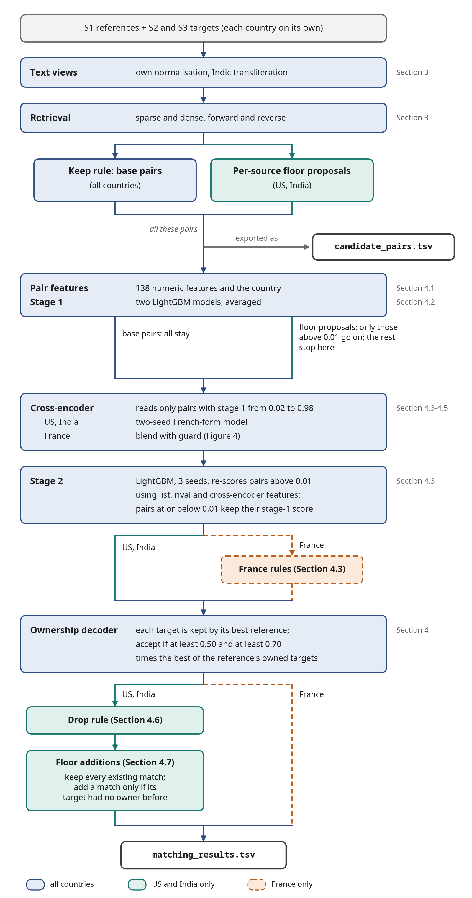
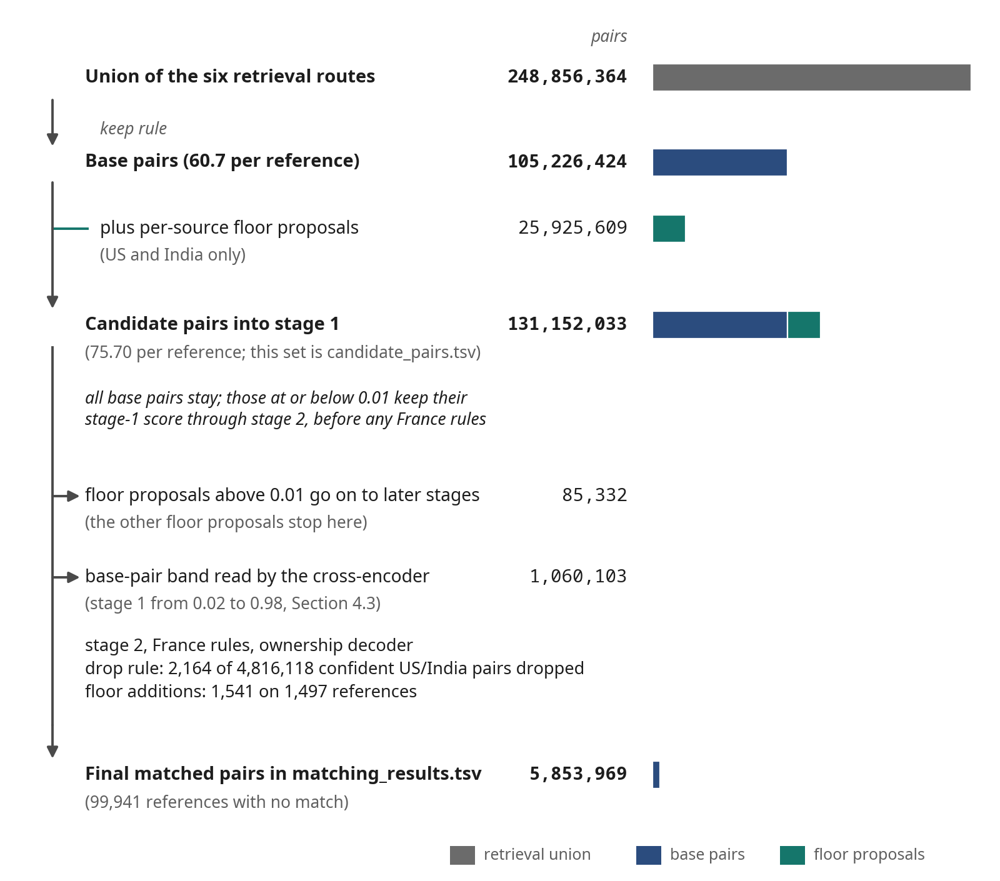
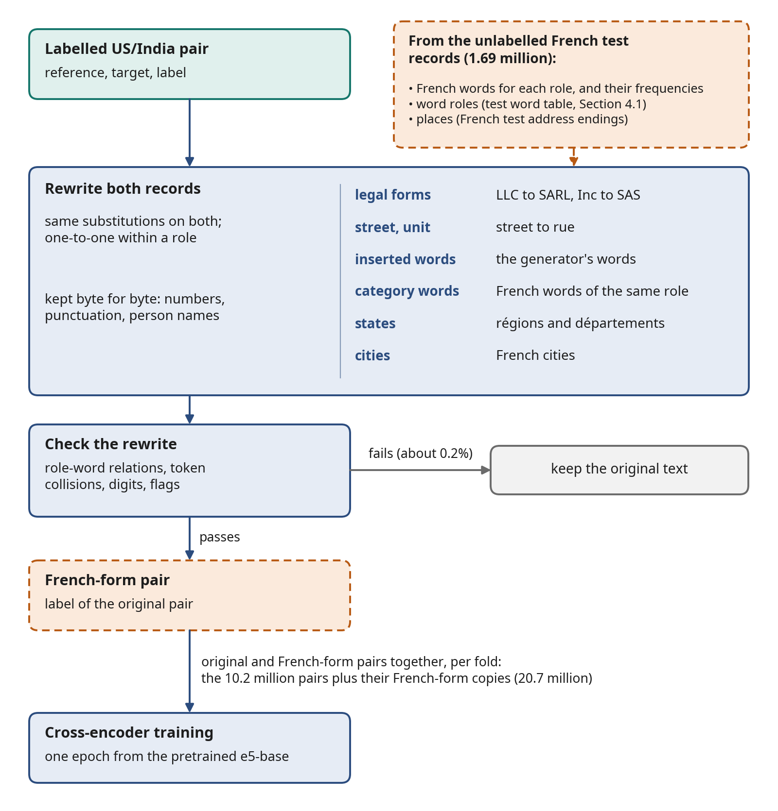
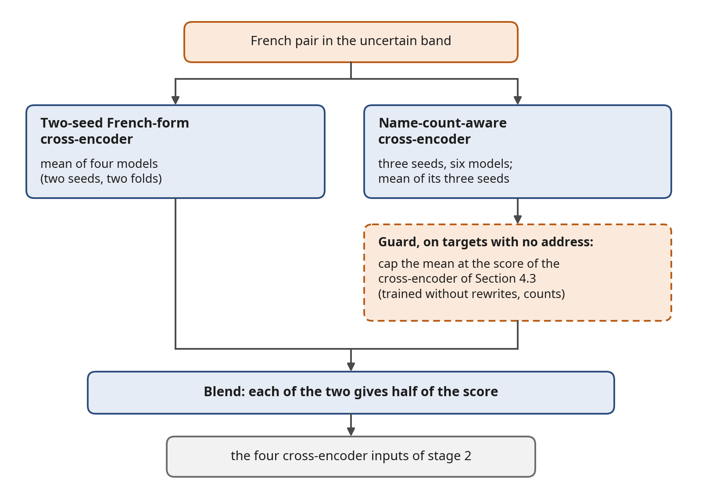
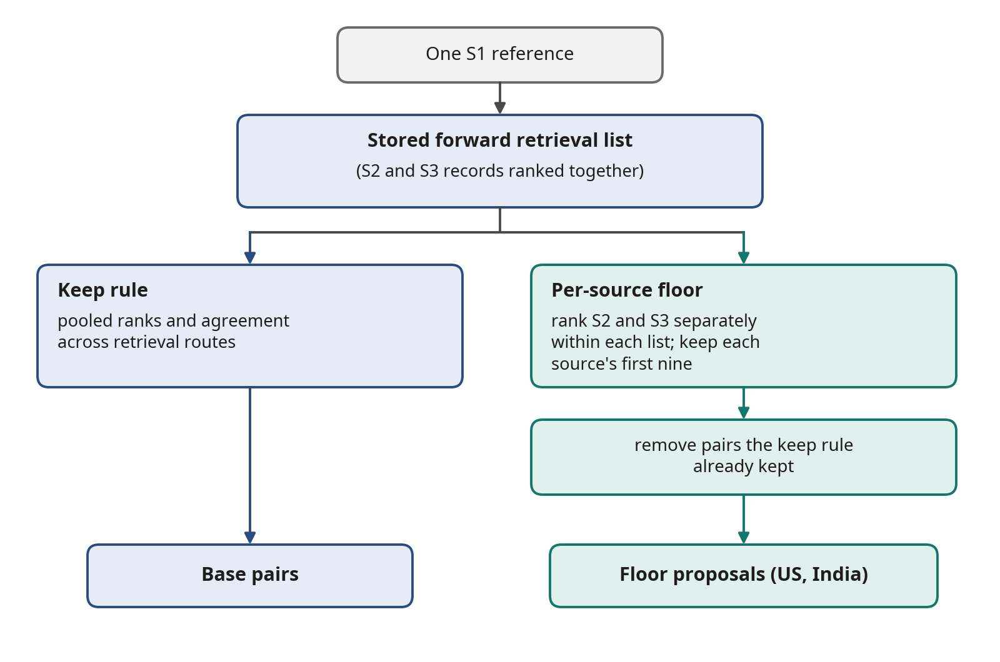
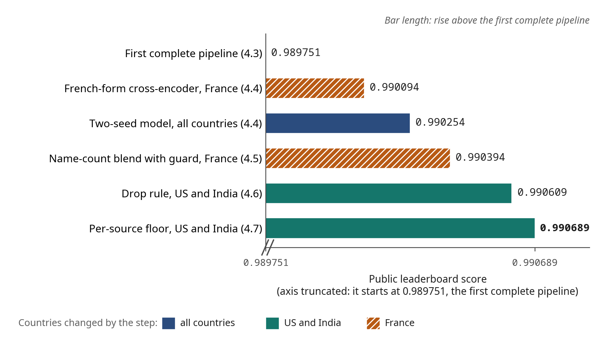

# ML Challenge 2026: Business Entity Resolution Solution

[Repository overview](../README.md) · [Reproduction guide](REPRODUCTION.md)

**Team Name:** Asi baat hai kya  
**Team Members:** Ankit Meda, Pritish Saha, Srinjoy Ganguly, Aadhar Batra  
**Submission Date:** 29 September 2026

Final submission: `matching_results.tsv` (MD5 `d5d44ade281e7213af54f65cb968be2d`) with `candidate_pairs.tsv` (MD5 `db8f7384277d1a862fd3b15224f00790`). Public leaderboard score 0.990689.

**At a glance**

| Item          | Summary                                                                                                                                                        |
|---------------|----------------------------------------------------------------------------------------------------------------------------------------------------------------|
| Task          | Match each Source 1 reference business to its records in Sources 2 and 3. Test countries: US, India and France; France has no labelled data.                   |
| Metric        | F0.5 for each reference, averaged over all references (macro F0.5)                                                                                             |
| Final score   | Public leaderboard 0.990689; validation (US/India, 60,000 references) 0.991508                                                                                 |
| Models        | multilingual-e5-small (118M parameters, MIT), frozen, for retrieval; multilingual-e5-base (278M parameters, MIT), fine-tuned as cross-encoders; LightGBM (MIT) |
| External data | None; only the files provided by the organisers                                                                                                                |
| Outputs       | `matching_results.tsv` and `candidate_pairs.tsv` (1,732,544 rows each; 5,853,969 matched pairs)                                                                |

**Contents**

1. [Executive summary](#1-executive-summary)
2. [Methodology](#2-methodology)
3. [Candidate generation (blocking)](#3-candidate-generation-blocking)
4. [Matching model](#4-matching-model)
5. [Results and error analysis](#5-results--error-analysis)
6. [Conclusion](#6-conclusion)
7. [Appendix](#appendix): [code artefacts](#a-code-artefacts), [additional results](#b-additional-results), and [licences, data, and fair play](#c-licences-data-and-fair-play)

---

## 1. Executive Summary

We retrieve possible matches for each Source 1 business, score them with gradient-boosted trees and text cross-encoders (models that read the two records' text together), and select matches jointly so that each target has at most one owner. Our main contributions are rival-aware scoring, features derived from recurring decoy patterns, and French-form training examples for a country without labelled task data. Starting from a complete pipeline with public score 0.989751, we investigated four gaps and improved the final score to 0.990689.

---

## 2. Methodology

### 2.1 Problem Analysis

**The task.** Source 1 (S1) is a deduplicated list of businesses. We call each S1 record a *reference*. Sources 2 and 3 (S2, S3) contain noisy copies of these businesses together with records of businesses that are not in S1; we call every S2 or S3 record a *target*. For each reference we must list all of its targets. A reference may have none (a *singleton*), one, or many.

| Records       |        S1 |        S2 |        S3 |
|---------------|----------:|----------:|----------:|
| Train records | 2,206,821 | 5,034,616 | 5,285,603 |
| Test records  | 1,732,544 | 4,887,273 | 5,082,316 |

Training data covers the US and India. The test set adds France: 259,452 of the 1,732,544 test references (15.0%) are French, and no French record has a label.

**Structure we found in the labels.** The 7,638,365 matched targets in the training ground truth each appear in exactly one reference's list, so each target has at most one owner. A reference has about 3.5 targets on average and up to 11. Several targets can therefore belong to the same reference, but if two references claim the same target, at most one is right. No true pair crosses a country, so we compare records only within a country.

About 26% of training targets belong to no reference; test has about 23% more targets per reference, and we estimate that about 40% of test targets belong to no reference.

**What makes it hard.** A similar name is not enough to establish identity.

- *Names.* After lowercasing and removing punctuation, a true pair has the exact same name only 21.8% of the time, and 686,000 S1 names are shared by more than one reference (chains and generic names).
- *Addresses.* The address usually settles the question, but 3.4% of S2 and 3.3% of S3 records have no address at all. When the address is missing, a common name may not distinguish between references with that name.
- *India.* India adds transliteration: about 13% of India S2 names are written in Indic scripts, never in S1.
- *France.* France adds a language absent from the labelled training data (accents, *rue* and *boulevard*, legal forms such as SARL and SAS, régions and départements).

**The decoy generator.** Reading pairs showed that 73% of the targets that belong to no reference (we call them decoys) are a copy of an S1 record with one address number shifted by one of d ∈ {1, 2, 3, 4, 5, 7, 9, 11, 13, 21}, usually with one business word inserted from a per-country list. On labelled training data, a target showing this shift against its closest reference is a decoy 97% of the time. The same fingerprint can be computed for France without labels.

**The metric.** We optimise F0.5 for each reference, then average over all references, including singletons. Per reference, F0.5 = 1.25·TP / (1.25·TP + FP + 0.25·FN). Precision counts more than recall: one wrong target added to a reference with a single true match takes its score from 1.0 to 0.556, and any prediction on a singleton scores 0. Adding a pair with calibrated probability p raises the expected score only if p is above 0.8 times the reference's current F0.5. We write small score differences in basis points: 1 bp = 0.0001 of macro F0.5.

### 2.2 Solution Strategy

**Approach Type:** Hybrid cascade. Our pipeline first retrieves plausible pairs, then combines a tree-based pair scorer with a text cross-encoder. A second tree model uses those scores together with competing claims on the same target. Finally, we choose which targets to assign to each reference. Section 4 gives the model details and thresholds.

**Core Innovation:** Modelling the one-owner-per-target competition and the decoy generator's fingerprints, and transferring the cross-encoder to an unlabelled country by training it on label-preserving French-form rewrites of labelled pairs.

Figure 1 shows the whole pipeline. Each country runs through it on its own, and France takes a different path at three points. Base pairs and floor proposals are treated differently after stage 1: every base pair stays in the cascade, while a floor proposal goes on only if stage 1 scores it above 0.01.

*Figure 1. The pipeline at a glance, with the section that describes each step.*

This overview combines the base pipeline and the expanded pipeline of Section 4.7. Existing pairs keep their original pair features and stage-1 scores. The expanded pipeline updates the affected lists and rival features, and its accepted pairs are added only when their targets have no owner in the base output. Cross-encoder scoring is selective: the band supplies stage-2 features, and the later drop rule separately checks high-scoring accepted pairs.

**How we measured.** We split the labelled references by entity, stratified by country: 60,000 for validation, 20,000 held out for audit, and 2,126,821 for training. The matching models never train on the held-out references, and retrieval runs against the full same-country gallery, as at test. To compare two versions, we measure their difference in macro F0.5 on the same references and report its standard error (SE).

In validation decoding a reference competes for a target only with other validation references, so contested targets (claimed by two or more references) are rare: 0.0098% of targets, against 0.347% on test.

For changes that act through competition we therefore built a second labelled check: stage 2 retrained five times, each time leaving out one fifth of the training references, so that every training reference is scored by models that never saw it while the whole training population competes (0.324% contested targets). We call this the out-of-fold check. Neither check covers France; for French changes we had label-free diagnostics and the public leaderboard.

**How the pipeline developed.** Table 1 shows how the pipeline developed and how each adopted change affected the score.

*Table 1. Development steps. Validation: US/India, 60,000 references, macro F0.5. Public: leaderboard score after the step.*

| Step                                                                                      | Countries changed | Validation |   Public |
|-------------------------------------------------------------------------------------------|-------------------|-----------:|---------:|
| Earlier pipeline (Section 4.3)                                                            |                   |    0.99031 | 0.988684 |
| First complete pipeline: all training references, new cross-encoder, rival features (4.3) | all               |   0.991189 | 0.989751 |
| Cross-encoder trained with French-form copies, used for France (4.4)                      | France            |        n/a | 0.990094 |
| Two-seed French-form cross-encoder for all countries (4.4)                                | all               |   0.991270 | 0.990254 |
| Blend with a name-count-aware cross-encoder, with guard (4.5)                             | France            |        n/a | 0.990394 |
| Drop rule for confident pairs the cross-encoder rejects (4.6)                             | US, India         |   0.991432 | 0.990609 |
| Per-source retrieval floor, additions only (4.7)                                          | US, India         |   0.991508 | 0.990689 |

For the France-only steps the public change is a change in the overall score after altering only French predictions. It is not a measured French score.

---

## 3. Candidate Generation (Blocking)

**Blocking keys used:** character 3-4-gram TF-IDF on three text views (full record, address, name); multilingual-e5-small dense embeddings; country as a hard partition. TF-IDF compares records by the short character sequences they share, giving more weight to rare ones; the dense embeddings are vectors from a small pretrained language model, so records with similar meaning land close together.

**Text views.** We wrote our own normalisation in the Python standard library: accent folding, legal-form and street-type equivalences, and an Indic-script folding and romanisation step. On top of it we learned from aligned training pairs a 906-word Indic-to-Latin dictionary and tables of word substitutions and equivalences. On Indic-script targets, exact agreement of the core name with the S1 name rises from 0.0% to 96.5% after this step. No external transliteration library or data is used.

**Retrieval routes.** All routes run per country against the full same-country gallery with exact top-k search on the GPU.

- *Forward routes* query each reference against all targets: sparse TF-IDF on the full, address and name views, and dense multilingual-e5-small (frozen) on the raw "name ; address" text, top 30 each.
- *Reverse routes* query each target against all references: dense top 10 and sparse full-view top 5.

The union of these six lists keeps 99.30% of true training pairs at 132 candidates per reference.

**Keep rule and candidate budget.** After the organisers announced that a smaller candidate set per reference would rank higher, we measured the cost of cutting the union on held-out data and chose a rule applied before any feature is computed. We keep a pair if any of these holds:

- at least two views retrieved it;
- it is among the first nine results of a forward view;
- it is among the first five of the reverse dense route;
- it is among the first three of the reverse sparse route.

On training references this cuts 132.3 to 54.1 candidates per reference and recall from 0.9930 to 0.9902. On test it keeps 105,226,424 of 248,856,364 pairs (60.7 per reference; no reference left without candidates). Rebuilt on the reduced set, the pipeline's public score moved from 0.987818 to 0.987661.

**Per-source floor.** The forward results in the keep rule rank S2 and S3 records together, which we later found crowds out some true targets (Section 4.7). For US and India the final pipeline also proposes every pair whose target is among the first nine records *of its own source* in any forward view but was cut by the pooled ranking. On test the per-source floor proposed 25,925,609 further pairs to the first model, and 85,332 of them (US 48,549; India 36,783) scored above 0.01 and went on to the later stages. A floor pair at or below 0.01 is never accepted.

**Candidate pairs generated:** 131,152,033 (75.70 per reference; median list length 66): the 105,226,424 pairs of the base routes and the 25,925,609 pairs proposed by the per-source floor. This is every pair that enters the first model. The reduction ratio against all same-country reference-target pairs is above 0.9999. Figure 2 follows the test pairs from retrieval to the final output.

*Figure 2. How the test pairs narrow from retrieval to the output (bars drawn to scale for the largest counts).*

The band count shown here covers the base candidates. Additional floor pairs receive cross-encoder scores where the routing requires them.

**How we ensured true matches were not lost.** Six routes of different kinds, reverse as well as forward, retrieve 99.30% of true training pairs; the budget cut was chosen from measured recall (0.9902 after the cut); and the models are trained on candidates made by the same routes and rule as the test candidates. True pairs that remain outside the candidate set account for 29.3 bp of loss on labelled data (Section 5). Most involve names shared by many references, which are difficult to distinguish even with a longer candidate list.

The per-source floor addresses the separate problem of true matches excluded by pooled ranking. Retrieval is exact search on one RTX 5090; larger galleries would need an approximate index, which we did not test.

---

## 4. Matching Model

**Features used:**
- Name features: rapidfuzz ratios and Jaro-Winkler on several name views, IDF-weighted token overlap on the core name, acronym and skeleton comparisons.
- Address features: token scores, a 15-feature block for house numbers (set overlap, substitutions versus insertions, a graded agreement level), IDF-weighted overlap on the core address.
- Other: retrieval ranks and scores per view; the reference's candidate count and score gaps; per-target competition (how many references claim the target, and the best rival's score); 13 decoy-generator features (the address-shift signature and word log-likelihood ratios for inserted, deleted and replaced words); the country as a categorical feature.

**Model type:** LightGBM (two stage-1 models and three stage-2 seeds); fine-tuned multilingual-e5-base cross-encoders (278M parameters, MIT); multilingual-e5-small (118M parameters, MIT) frozen for retrieval and similarity features.

**Threshold selection method:** each target is kept only by its highest-scoring reference; a pair is accepted if its final probability is at least 0.50 and at least 0.70 times the best probability among the reference's owned targets. We call this step the ownership decoder. Both values sit in the middle of a flat plateau on validation and were confirmed on the out-of-fold check. The thresholds of the later rules were fixed before their full labelled evaluation.

### 4.1 Pair features

Stage 1 uses 138 numeric features and the country. The word log-likelihood ratios (how strongly word changes are associated with likely decoys) are learned per country without ground-truth labels. We compare word changes in pairs flagged by the address-shift rule as likely decoys with pairs that share an address number and show no shift. US and India test pairs use the table learned on training records.

For France the table is learned the same way on the unlabelled French test records; it recovers the generator's French word list (groupe, participations, holding, france, distribution, développement, international), and switching it off cost 0.0027 on the public leaderboard in an early test. IDF weights are counted per country on each split's own records, for test on the unlabelled test records. France has no training rows, so its country value falls into LightGBM's missing-value branch.

### 4.2 Stage 1

Two LightGBM models with different settings (127 leaves, learning rate 0.05; and 255 leaves, learning rate 0.03) are trained on all 115,103,968 candidate pairs of the 2,126,821 training references; early stopping used the validation set. Their probabilities are averaged. For stage 2 training, each pair needs a stage-1 score from a model that did not train on it. We obtain these scores with five-fold cross-validation, keeping each reference and its pairs in the same fold.

### 4.3 The first complete pipeline

Early in development the decoy-generator features gave one of the largest gains (validation 0.9802 to 0.9860). Three later additions shaped the design.

*Stage 2.* Stage 1 usually ranked each reference's candidates well. The harder decision was how far down that list to accept matches. A second LightGBM model re-scores every pair whose stage-1 probability is above 0.01. It uses:

- the pair's place in its reference's list;
- agreement with the reference's other confident targets;
- e5-small similarities between records;
- 12 stage-1 inputs.

*Cross-encoder.* A cross-encoder reads both records together and estimates whether they describe the same business. Unlike a similarity score computed from separate record embeddings, it can compare the words and address details across the pair directly.

Its input is `reference "name | address"` paired with `target "name | address"`, truncated at 96 tokens, and its output is a match probability. We fine-tune multilingual-e5-base for one epoch (learning rate 3e-5, batch 96) on labelled training pairs, weighted towards hard cases: pairs stage 1 found uncertain, decoys with the address-shift signature, and references that share a name.

It scores only pairs with stage-1 probability between 0.02 and 0.98 (1,060,103 test pairs). We call this range the uncertain band. Its score works better as four input features of stage 2 than as a fixed blend (validation +0.0005, public +0.00029).

Stage 2's training rows therefore need cross-encoder scores from a model that did not see them: we split the references in two by a hash of the ID, train one cross-encoder per half and score each half with the other half's model; validation and test use the mean of the two.

*France rules.* Inspection of French predictions revealed two recurring errors, and we added one rule for each.

- A French pair is raised to at least 0.95 when all of these hold: the target's letters equal the reference's initials; exactly one candidate reference of that target matches in this way; the house number agrees exactly; there is no shift signature; and the pair's score is at least 0.001.
- A same-address pair differing by one replaced category word (club, école, amicale, comité, taken automatically from the French word table) is lowered to at most 0.05.

Both rules change the stage-2 scores before decoding; the decoder then runs on the changed scores. Each rule was kept after one public upload (overall +0.000187 and +0.000415).

We then assembled the first complete version of the final design. Stage 1 was retrained on all training references instead of a 400,000-reference sample (validation +0.00022). The cross-encoder was retrained on the new folds with more hard negatives (10.2 million pairs per half).

Stage 2 received four *rival features*. For a pair (reference, target) they are:

- the best stage-1 score of any other reference on the same target;
- the pair's margin over it;
- the number of rivals scoring at least 0.5;
- the reference's rank among all claimants.

Unlike the stage-1 competition features, which describe retrieval scores, these rival features describe the learned model's match scores. For training rows, rival scores come from the stage-1 model of the same fold, as they would at test time. Rival features alone gained +0.00036 (SE 0.00009) on validation.

Stage 2 is averaged over three seeds. Together, these changes raised validation from 0.990531 to 0.991189 (+0.000658, SE 0.000099) and the public score from 0.988684 to 0.989751.

### 4.4 Gap 1: the cross-encoder was never fine-tuned on French text

**What we saw.** When stage 1 was retrained on all references, 2,366 French pairs that the old stage 1 had scored above 0.98 fell into the cross-encoder's range, and the cross-encoder scored them low (mean 0.111). On labelled US/India pairs the same movement was mostly correct. This raised a specific question: was the cross-encoder treating French wording as evidence against a match?

**How we checked.** We rewrote the labelled validation pairs into French form, keeping their labels, and scored them. A cross-encoder trained only on US/India text dropped from AUC 0.91 on the original pairs to 0.66 on the French-form copies. (AUC is the chance that a random true pair scores above a random false one.) The underlying pairs and labels were unchanged, so this was the model reacting to French surface forms.

**The fix: French-form training text.** We rewrite every labelled training pair into French form and train on the original and the rewrite together (Figure 3). The rewrite maps words by their role, one-to-one within a role:

- legal forms (LLC to SARL, Inc to SAS);
- street and unit words (street to rue);
- the generator's inserted words;
- category words;
- states to régions and départements;
- cities to French cities.

The same substitutions are applied to both records of a pair. Numbers, punctuation and person names are kept byte for byte.

The French vocabulary comes from the unlabelled French test records (1.69 million). They give the French words for each role and their frequencies. The word roles come from the word table of Section 4.1, built from the test records using these fixed address rules. The places come from French test address endings.

Each rewritten pair is then checked. The role-word relations between the two records, new token collisions, digit sequences and equality flags must all be unchanged. The roughly 0.2% of pairs that fail keep their original text. The labels are those of the original US/India pairs; no French label exists or was used.

*Figure 3. How a French-form training pair is made from a labelled US/India pair.*

**The gain.** A first version scored AUC 0.90 on the French-form validation copies, and on US/India validation F0.5 it matched a control trained on the same number of unrewritten pairs (−0.00002, SE 0.00007). We then trained it on the full folds of Section 4.3: per fold, the 10.2 million pairs plus their French-form copies (20.7 million), one epoch from the pretrained e5-base. Using it for French pairs raised the overall public score from 0.989751 to 0.990094.

With a second seed this gives four models (two seeds, two folds), whose mean we call the two-seed French-form cross-encoder. On US and India it also beat the cross-encoder trained without French text (out-of-fold check +0.000072, SE 0.000009; validation 0.991189 to 0.991270), so we use it for all three countries; the public score became 0.990254.

Stage 2 was trained with scores from the cross-encoder of Section 4.3. At test time it is applied with the newer cross-encoder scores (this model, and for France the blend of Section 4.5) in the same four inputs, without refitting; a refit changed validation by only +0.0000007.

### 4.5 Gap 2: in France, a shared name did not lower the score

**What we saw.** For a target with no address, a name shared by many references should make the model less confident about any particular owner. In US and India it did; in France it did not.

**How we checked.** We tested this with a control: score each reference against a copy of itself with the address removed. In US and India the score falls as more references share the name (rank correlation −0.42 and −0.72). In France it stayed at about 0.80 whether the name was unique or shared by 50 references (rank correlation −0.06).

**The fix: tell the model how common the name is.** A name can be a strong textual match and still identify many different businesses. We therefore give the cross-encoder the number of reference businesses sharing that name, so it can distinguish a rare name from a common one.

Each side of the input becomes `same-name refs: <bucket> | name | address`, where the bucket (0, 1, 2-3, 4-9, 10-29, 30-99, 100+, or none) counts the S1 records of the same country and file whose core name equals this record's. Training pairs take the count from the training S1 records, test pairs from the unlabelled test S1 records, and French-form rows keep the count of their original record.

The model uses the recipe and data of Section 4.4 with a maximum length of 112 tokens and a random half of the pairs per fold (10.35 million), with three seeds: six models.

*Why it is blended and guarded.* Used alone for US and India, the count-aware model gave no gain on validation (−0.0000075, SE 0.000065) and accepted more addressless targets with a unique name (38 new acceptances: 17 true, 21 false).

We therefore use it only for France, as half of a blend with the two-seed French-form cross-encoder. On addressless targets we cap the mean of its three seeds (not each seed) at the score of the cross-encoder of Section 4.3, trained without French text or counts. Weights and cap were fixed before evaluation. Figure 4 shows the blend.

*Figure 4. How a French pair's cross-encoder score is formed: the blend and the guard.*

**The gain.** With the name count in the input, confidence in the French control decreased as more references shared the name (median score 0.82, 0.55, 0.21 and 0.09 for names shared by 1, 2-5, 6-20 and 21-50 references), and AUC on the validation cross-encoder range rose from 0.928 to 0.942. On US/India validation, the blend performed similarly to the two-seed model alone (+0.000012, SE 0.000044). The overall public score rose from 0.990254 to 0.990394 after changing only French predictions.

### 4.6 Gap 3: confident stage-1 pairs were never checked by the cross-encoder

**What we saw.** The cross-encoder only scores pairs with stage-1 probability between 0.02 and 0.98. Pairs above 0.98 are judged by stage 1 and stage 2 without any cross-encoder score, and nearly all are accepted. On validation, 62 of the 195,384 accepted pairs above 0.98 were false.

**How we checked.** When we scored them with the two-seed French-form cross-encoder, 33 of the 62 false pairs scored below 0.10, and none of a random sample of 2,999 true pairs did.

**The fix: a drop rule.** After the decoder, drop an accepted pair if its stage-1 probability is above 0.98 and the mean of the four cross-encoder models is below 0.10; nothing is re-assigned. We fixed the rule before scoring the full validation set.

*Why not France.* We had set a limit in advance: France is included only if its drop rate is at most three times the US/India rate. It was 0.559% against 0.045%, so France is excluded; most flagged French targets had "France", "Développement" or "& Associés" appended to the name (Section 5).

**The gain.** On the full validation set the rule drops 42 pairs (33 false, 9 true): +0.000162 (SE 0.000040). On the out-of-fold check it drops 1,976 of 6,943,923 confident accepted pairs (1,360 false, 616 true): +0.000136 (SE 0.000006), positive in each of five blocks of references. On test it drops 2,164 of 4,816,118 confident US/India pairs. The public score rose from 0.990394 to 0.990609.

### 4.7 Gap 4: good candidates crowded out of retrieval

**What we saw.** We broke down the remaining loss on the out-of-fold check (two-seed cross-encoder plus the drop rule) by cause. Of 84.2 bp, missed matches account for 75.2 bp, and 29.3 bp come from 72,377 true pairs that retrieval never proposed.

**How we checked.** We grouped those pairs by the reason they were missed. One group of 8,618 pairs (3.3 bp) was among the first nine records of its own source in some forward view, but outside the first nine when S2 and S3 are ranked together. Close records from the other source filled the pooled ranks and pushed the true target out of the keep rule.

**The fix: a per-source floor.** Propose every pair whose target is among the first nine records of its own source in any forward view but was cut by the pooled ranking (Section 3). A narrower first version (first three per source) held only 11 true pairs among 49,472 on validation, so we used the first nine.

A pooled retrieval list can be dominated by records from one source. A useful target may rank highly within its own source but still fall outside the pooled cutoff. Figure 5 shows how the floor recovers such targets.

*Figure 5. A target cut by the pooled ranking can still be proposed by the per-source floor.*

The floor reuses the stored forward lists. It does not search a new data source or assume that the extra candidates are matches. They still pass through the scoring and decision stages.

New pairs get pair features (with all proposed pairs on their targets present) and stage-1 scores; those above 0.01 get updated rival features and stage-2 scores, with cross-encoder scores where the cascade requires them, then the decoder and the drop rule. Existing pairs keep their features and stage-1 scores, and references and targets not connected to a new pair keep their previous final score.

**The gain.** On US/India validation the floor gained +0.0000767 (SE 0.0000346): 52 true and 7 false additions, no removals.

*Why additions only.* The expanded candidate lists also changed some existing predictions. On test, the full decoder removed 246 matches, mostly because a reference's own stage-2 score fell after its list changed. Validation produced no removals, so it did not tell us whether these changes were beneficial. We kept the existing matches and accepted an additional match only if the expanded pipeline selected it and its target was previously unassigned. This gave 1,541 additions on 1,497 references (India 1,418, US 123). The public score rose from 0.990609 to 0.990689.

---

## 5. Results & Error Analysis

**F0.5 Score (macro):** on the 60,000 validation references (US and India only), the final US/India pipeline scores 0.991508; the first complete pipeline scored 0.991189. There is no labelled score for France. Public leaderboard: 0.990689.

Figure 6 shows the public score after each step of Table 1, starting from the first complete pipeline.

*Figure 6. Public leaderboard score after each step (bar length shows the rise above the first complete pipeline).*

**Where the remaining loss is.** In the breakdown of Section 4.7 (Table B2), missed matches are 89% of the 84.2 bp and pairs whose target has no address about 75%. Of the addressless misses, 43.3 bp belong to references whose exact name is shared by other references of the same country (typically four, up to 241). References with a single true match that receive no prediction cost 14.0 bp.

**Common false positives (wrong merges):**
- decoys that do not carry the address-shift signature, for example a changed legal form or a one-letter name change at the same address;
- same-name siblings of chains and generic names;
- addressless targets with a slightly corrupted name attached to the wrong one of several same-named references.

**Common false negatives (missed matches):**
- addressless targets whose owner's name is shared by other references, where the text holds no evidence of which reference is the owner;
- heavily changed names that share only generic words and are never retrieved;
- references with a single true match that falls below the threshold.

**Limitations.** France has no labelled data, so every choice for France was checked indirectly: on French-form versions of labelled US/India pairs and through the overall public score. The French-form text is an approximation of real French records, and some of its word mappings are imperfect, so French names that end in very common words may be scored lower than they should be. The pairs added by the retrieval floor are least reliable when the target record has no address.

---

## 6. Conclusion

The final system combines three kinds of evidence: similarity between records, competition between possible owners, and recurring patterns in the generated decoys. French-form training examples and name counts helped the text model handle the unlabelled country, while the final improvements came from checking confident predictions and recovering candidates lost to pooled ranking. The hardest remaining cases are targets with missing addresses and names shared by several reference businesses.

---

## Appendix

### A. Code Artefacts

The repository contains the core code in `src/`, research-stage scripts in `research/`, and pinned dependencies in `requirements.txt`. The [reproduction guide](REPRODUCTION.md) gives the commands for each stage in order, from the raw TSV files to the two output files, and lists the model checkpoints and intermediate files each stage needs.

**Checksums of the submitted files.** `output/matching_results.tsv` MD5 `d5d44ade281e7213af54f65cb968be2d`; `output/candidate_pairs.tsv` MD5 `db8f7384277d1a862fd3b15224f00790` (1,732,544 rows each; 5,853,969 matched pairs; 99,941 references with no match).

**Run-to-run variation.** Retraining gives slightly different scores from run to run. Cross-encoder scoring uses bf16 arithmetic whose results depend on batch composition, and a small share of pairs near a threshold can change decision; LightGBM results can also vary with thread count.

**Names used in the code.** The following table links the components described above to their names and entry points in the code. Paths are relative to the repository root (`BER_ROOT`).

| Description in this document                                 | Tag in code and files                               | Main scripts                                                                                                                                                              |
|--------------------------------------------------------------|-----------------------------------------------------|---------------------------------------------------------------------------------------------------------------------------------------------------------------------------|
| Text views, tables, retrieval, keep rule                     | v7 candidates                                       | `src/text_views.py`, `src/mine_tables.py`, retrieval and `build_pairs` scripts in `src/`                                                                                  |
| Stage 1 on all training references                           | v12 (`lgbm_v12`, `lgbm_v12b`)                       | `src/pair_features.py`, `cloud/chain_v12_cloud.sh`                                                                                                                        |
| Cross-encoder of Section 4.3; rival features; 3-seed stage 2 | `ce_v12f2A/B`; E2; `stage2_v12ce2_E2`               | `cloud/ce2_arm.sh`, `research/scripts_43/`, `src/stage2.py`, `src/stage2_apply.py`                                                                                        |
| France rules                                                 | acronym raise, catswap drop                         | `src/apply_acronym_rule.py`, `src/apply_catswap_drop.py`                                                                                                                  |
| French-form rewrite; two-seed French-form cross-encoder      | transplant, fr12; X2 (`fr12_ceA/B`, `fr12s1_ceA/B`) | `research/scripts_49/`, `research/scripts_55/` (rewrite and training sets), `research/scripts_44/train_ce_text_swap.py` (trainer), `research/scripts_cntall/build_all.sh` |
| Name-count-aware cross-encoder; blend with guard             | frnlp_cnt, CNTX3G; ENS                              | `research/scripts_70/`, `research/scripts_62/guard.py`, `research/scripts_62/ens.py`                                                                                      |
| Drop rule for confident pairs                                | UB10                                                | `research/scripts_62/ub10_test.py`, `research/scripts_62/ub10_apply.py`                                                                                                   |
| Per-source retrieval floor, additions only                   | SF8, SF8a                                           | `research/scripts_92/`                                                                                                                                                    |
| Candidate file export; small helper steps                    | candfull                                            | `research/pkg/cand_full/build_candfull.py`, `pipeline/`                                                                                                                   |

### B. Additional Results

*Table B1. Labelled evidence for each step (US/India; paired differences with SE).*

| Step                                                            | Validation (60,000 references)                         | Out-of-fold check (2,126,821 references)                |
|-----------------------------------------------------------------|--------------------------------------------------------|---------------------------------------------------------|
| All references, new cross-encoder, rival features               | +0.000658 (SE 0.000099)                                | not built at the time                                   |
| Two-seed French-form cross-encoder instead of the earlier one   | 0.991189 to 0.991270                                   | +0.000072 (SE 0.000009)                                 |
| Name-count blend (France only; native pairs as a no-harm check) | +0.000012 (SE 0.000044)                                | −0.000005 (SE 0.000007)                                 |
| Drop rule for confident pairs                                   | +0.000162 (SE 0.000040); 33 false and 9 true drops     | +0.000136 (SE 0.000006); 1,360 false and 616 true drops |
| Per-source floor                                                | +0.000077 (SE 0.000035); 52 true and 7 false additions | not built                                               |

*Table B2. Remaining loss by error type (out-of-fold check, two-seed cross-encoder and drop rule, US/India).*

| Error type                           |   Pairs | Loss (bp) |
|--------------------------------------|--------:|----------:|
| Missed match, target without address | 143,985 |      59.1 |
| Missed match, target with address    |  36,800 |      16.1 |
| False match, target without address  |   4,132 |       5.3 |
| False match, target with address     |   4,130 |       3.7 |
| Total                                | 189,047 |      84.2 |

Where missed matches stop:

| Where the missed match stops        | Loss (bp) |
|-------------------------------------|----------:|
| Final score below 0.5               |      36.5 |
| Never retrieved                     |      29.3 |
| Removed by the 0.70 relative rule   |       6.6 |
| Stage-1 score at or below 0.01      |       2.0 |
| Lost ownership to another reference |       0.5 |

**Compute.** Development and test inference ran on one workstation (AMD Ryzen 9 9950X, 123 GB RAM, one RTX 5090 32 GB). Stage 1 on all training references, its out-of-fold scores and the cross-encoders of Sections 4.3 to 4.5 were trained on rented 8×A100 nodes. The full-data stage-1 chain took 6 h 11 min on one node; each French-form cross-encoder model took about 3 h on one A100 and each count-aware model about 100 min.

### C. Licences, data and fair play

**No external data.** The pipeline uses only the files provided by the organisers. It makes no calls to external databases, APIs, geocoders, address parsers or gazetteers, and uses no data from the internet. All dictionaries and word tables are learned from the provided files.

**Models and licences.**

| Model                                                                                    | Parameters | Licence | Use                                                                              |
|------------------------------------------------------------------------------------------|-----------:|---------|----------------------------------------------------------------------------------|
| intfloat/multilingual-e5-small                                                           |       118M | MIT     | frozen; dense retrieval and stage-2 similarity features                          |
| intfloat/multilingual-e5-base, fine-tuned by us: cross-encoder of Section 4.3 (2 models) |  278M each | MIT     | stage-2 training features; reference score for the France cap                    |
| same base: two-seed French-form cross-encoder (4 models)                                 |  278M each | MIT     | cross-encoder for US and India; half of the France blend; drop rule; floor pairs |
| same base: name-count-aware cross-encoder (6 models)                                     |  278M each | MIT     | half of the France blend                                                         |
| LightGBM (2 stage-1 models, 3 stage-2 seeds)                                             |        n/a | MIT     | pair classifiers                                                                 |

Two pretrained models are used, both MIT: intfloat/multilingual-e5-small (about 118M parameters, frozen) for dense retrieval and stage-2 similarity features, and intfloat/multilingual-e5-base (about 278M parameters) as the starting point of every cross-encoder. The largest model is 278M parameters.

The main libraries and their licences are PyTorch (BSD-3-Clause), transformers, tokenizers, safetensors, sentence-transformers and pyarrow (Apache-2.0), LightGBM, polars, rapidfuzz and DuckDB (MIT), and numpy, scipy and scikit-learn (BSD-3-Clause). The GPL-licensed Unidecode package is not used by the final pipeline.

**Labels.** The matching models are trained with the provided training labels. We used no test ground truth and no manually assigned match labels, and no model in the final pipeline was trained on predicted matches between test records. The word tables in Section 4.1 compare groups identified by fixed address rules, without ground-truth labels.

**How we use the provided test records.** As described where each component is introduced, the pipeline reads the unlabelled test records in these ways:

- retrieval and all pair features are computed over the test galleries;
- IDF and name-collision counts are counted per country on test records;
- the French word table and the category-word list of the France rules are built from French test records using these fixed address rules, without ground-truth labels;
- the French words, word roles and places used to rewrite training pairs into French form come from the French test records (Section 4.4);
- the name counts given to the count-aware cross-encoder at test time are counted on the test S1 records (Section 4.5).

We used the aggregate public leaderboard score to decide whether to keep each change.
